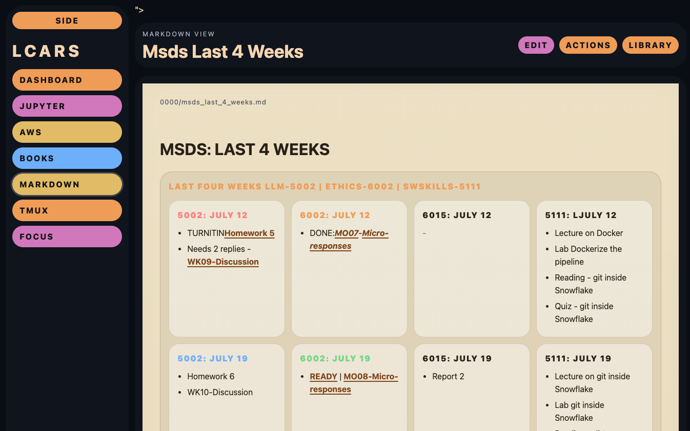
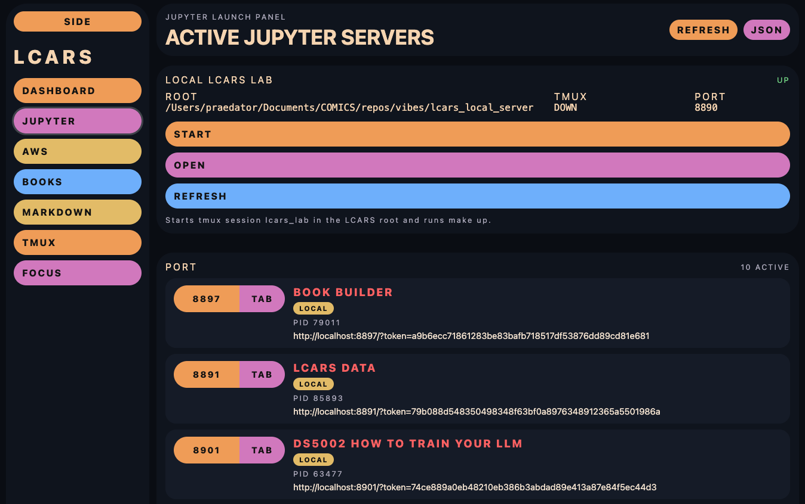
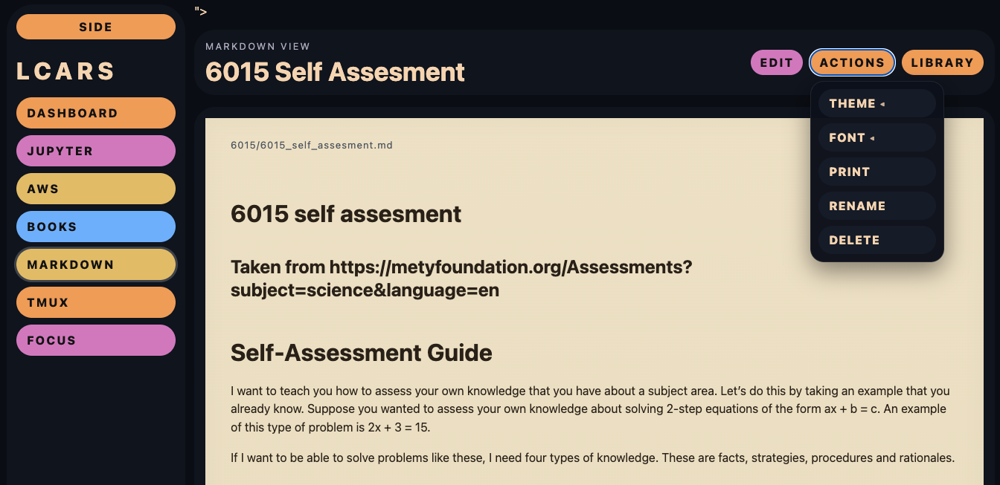

# LCARS

> A filesystem-first productivity dashboard built with Flask.

LCARS is a personal workspace that combines notes, books, project planning, focus sessions, development tools, and infrastructure management into a single interface.

The project began as a simple launcher for Jupyter servers and gradually evolved into a general productivity dashboard. Throughout its evolution, one principle has remained constant:

> **Your files remain your files.**

LCARS intentionally avoids storing your work in a database. Markdown documents, books, sounds, and configuration all remain ordinary files on disk that can be edited with Vim, VS Code, Obsidian, GitHub, or any other tool you prefer.

LCARS simply provides a richer way to view and work with them.

> LCARS is not intended to replace editors like Vim, VS Code, or Obsidian. Instead, it complements them by providing a dashboard-oriented view of your work while keeping every document as an ordinary file on disk.


---

# Philosophy

LCARS follows a few simple ideas.

- 📄 Markdown is the source of truth.
- 📁 The filesystem is the database.
- 🔀 Git works naturally.
- 🎨 Visualization should enhance your files, not replace them.
- 🛠 Configuration should live in editable JSON rather than hidden application state.

The goal is to add capabilities without locking your content into a proprietary format.

---

# Features

### Markdown Workspace

- Render and edit Markdown
- Paper and Dark themes
- Folder organization
- Persistent filtering
- Rename / delete
- Print support
- Semantic Markdown rendering

Current semantic blocks include:

- Matrix (RxC)
- Matrix (Rx1) for auto-sized vertical lists
- Matrix (1xC)

allowing ordinary Markdown to become visual dashboards while remaining portable.

---

### Books

- Plain-text library
- S3-backed PDF catalog
- Comfortable reading interface
- External storage support

---

### Focus Mode

- Pomodoro timer
- Configurable work/break lengths
- Resume support
- Optional background sounds
- Custom sound configuration

---

### Jupyter Dashboard

- Local Jupyter launch
- Remote Jupyter launch
- tmux integration
- One-click LCARS development environment startup

---

### AWS Dashboard

- EC2 instance monitoring
- Start / Stop instances
- Cost-control workflow
- Jupyter launch integration

---

### Utilities

- Local link dashboard
- tmux monitor
- Settings management
- External content roots

---

# Screenshots

---

## Semantic Markdown Matrix

> 

---

## Dashboard

> 

---

## Markdown Workspace

> 

---

# Installation

```bash
git clone <repo>

cd LCARS

python3 -m venv .venv
source .venv/bin/activate

pip install -r requirements.txt

python app.py
```

Open:

```
http://127.0.0.1:5000
```

---

# Configuration

LCARS is configured using a handful of simple JSON files.

| File | Purpose |
|------|---------|
| `content_config.json` | External Markdown, Books, and Sounds folders |
| `focus_config.json` | Focus timer settings and audio |
| `aws_servers.json` | AWS EC2 instances |
| `s3_library_catalog.json` | Commit-safe PDF titles and S3 object filenames |
| `s3_library.local.json` | Local S3 bucket, region, and private prefix |
| `links.json` | Dashboard links |
| `jupyter_servers.json` | Local and remote Jupyter servers |

---

# External Content

One of LCARS' design goals is separating **application code** from **user content**.

For example:

```json
{
    "markdown_dir": "/Users/me/Documents/LCARS/markdown",
    "books_dir": "/Users/me/Documents/LCARS/books",
    "sounds_dir": "/Users/me/Documents/LCARS/sounds"
}
```

This allows your notes and books to live in their own Git repository while LCARS itself can be upgraded independently.

---

# S3 PDF Library

LCARS can present a PDF library stored in an S3 bucket without committing AWS credentials or private S3 base paths.

Put public catalog entries in `s3_library_catalog.json`:

```json
{
    "books": [
        "01_BaMI-HTM-Overview.pdf"
    ]
}
```

Use object entries when you want custom titles, stable IDs, or categories:

```json
{
    "books": [
        {
            "id": "beginning-aws-machine-intelligence",
            "title": "Beginning AWS Machine Intelligence",
            "filename": "01_BaMI-HTM-Overview.pdf",
            "category": "Machine Learning"
        }
    ]
}
```

Put private S3 base configuration in environment variables, ignored `.env`, or ignored `s3_library.local.json`:

```bash
S3_BUCKET=my-library
S3_REGION=us-east-1
S3_PREFIX=c94f7b28e813a50d6ae4
S3_BOOK_CACHE_DIR=/Users/me/Documents/LCARS/books/s3_pdfs
```

The equivalent local JSON form is:

```json
{
    "bucket": "my-library",
    "region": "us-east-1",
    "prefix": "c94f7b28e813a50d6ae4",
    "cache_dir": "/Users/me/Documents/LCARS/books/s3_pdfs"
}
```

`S3_BOOK_CACHE_DIR` is optional. If omitted, LCARS caches S3 PDFs under the configured `books_dir` in `s3_pdfs/`.

LCARS resolves `/book/<id>` through the catalog and redirects to:

```text
https://BUCKET.s3.REGION.amazonaws.com/SECRET_PREFIX/FILENAME.pdf
```

The Books page `OPEN` button downloads a missing PDF to the local cache and then opens the cached file. The `WEB` button keeps the direct S3 fallback.

No AWS access key is required to open PDFs when the selected bucket prefix allows anonymous read-only `s3:GetObject`.

---

# Semantic Markdown

LCARS extends ordinary Markdown with optional semantic renderers.

Example:

```markdown
## Matrix (2x2): Weekly Priorities

### URGENT
* Finish lecture

### ADMIN
* Submit grades

### DEADLINE
* Assignment due Friday

### CREATIVE
* AI ideas

## End Matrix
```

renders as a visual matrix while the underlying document remains ordinary Markdown.

For a vertical matrix that grows as you add sections, use literal `R` for rows:

```markdown
## Matrix (Rx1): Reading Queue

### FIRST
* item one

### SECOND
* item two

### THIRD
* item three

## End Matrix
```

LCARS renders that as a one-column matrix with one row per section.

---

# Development Status

LCARS is an actively developed personal productivity system.

Although it is stable enough for daily use, the project is still evolving and new capabilities are added regularly.

Current areas of active development include:

- Books
- Semantic Markdown components
- Trading dashboard
- Workflow automation
- Additional visualization blocks

---

## Changelog

See [CHANGELOG.md](CHANGELOG.md) for the complete release history.

---

# License

Choose the license that best matches how you want others to use the project.
